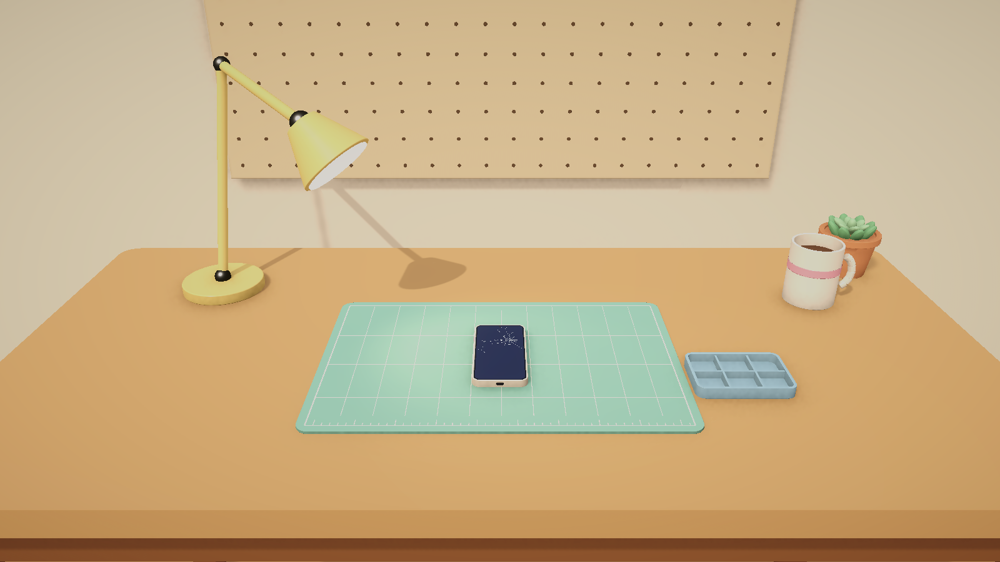
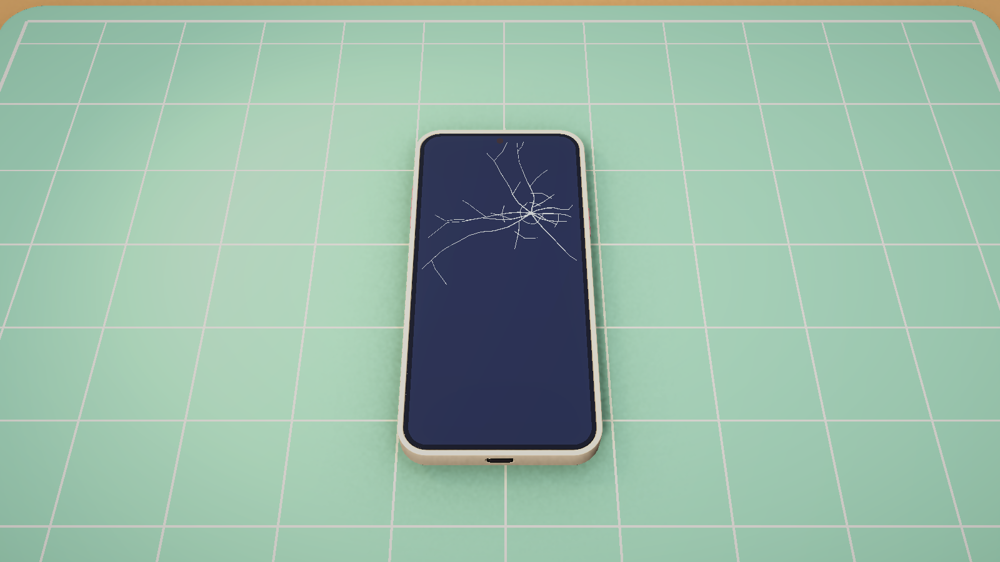
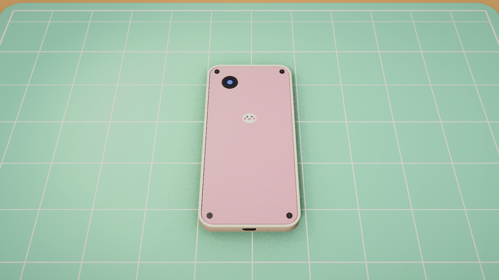
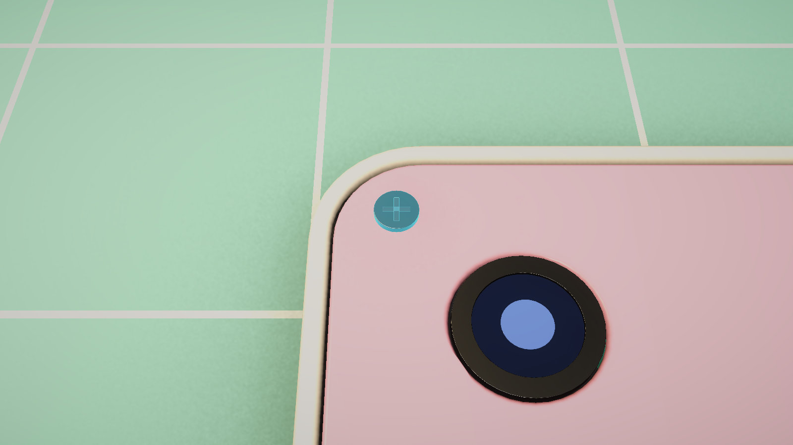

# Milestone 1: Interactive phone on a workbench

**Objective:** a basic scene with a phone on a workbench where the player can **rotate** the phone, **zoom in**, and **select a component** with the mouse.
**Status:** implemented, built headlessly, covered by automated tests (see *Verification* at the end).

---

## 1. Open and play

1. Open the project in **Unity 6000.0.32f1** (Unity Hub).
2. Open `Assets/_Project/Scenes/Sandbox/M1_Workbench.unity` and press **Play**.
3. If the scene, prefabs or materials are ever missing or broken, run **Tools ▸ Phone Repair ▸ Run Milestone 1 Setup**. It's safe to repeat: it keeps existing materials and data assets, updates the prefabs in place, and **regenerates the scene**. Copy the scene before hand-editing it.

Already done for you (headless, by the setup):

* **URP** installed (`com.unity.render-pipelines.universal` 17.0.3) and assigned: `Assets/_Project/Settings/Rendering/PRS_URP.asset` (+ renderer with SSAO, HDR, MSAA 4×, soft shadows, 4 m shadow distance tuned for tabletop scale).
* TextMeshPro Essential Resources imported.
* `com.unity.inputsystem` added to `testables` in `Packages/manifest.json` (gives tests the `InputTestFixture`).
* Environment lighting baked for `M1_Workbench` (ambient + one reflection probe, no lightmaps), so glossy and metal parts look the same in the editor, in Play mode and in builds. After changing the room, press **Generate Lighting** in *Window ▸ Rendering ▸ Lighting* (a few seconds).

The template's `Assets/Scenes/SampleScene.unity` is unused and can be deleted.



Optional: **Player Settings ▸ Active Input Handling** is currently *Both*. Our code only uses the Input System package, so you can switch it to *Input System Package (New)*.

---

## 2. Controls

| Input | Action |
|---|---|
| **Left click** | select a part (click empty space to deselect) |
| **Double-click** / **F** | frame the selected part (F with nothing selected = reset camera) |
| **Right drag** or **WASD / arrows** | rotate the phone (trackball) |
| **Left drag on empty space** | rotate too (trackpad friendly) |
| **Mouse wheel** | zoom towards the cursor |
| **Middle drag** | pan (clamped; zooming out recentres) |
| **Space** | flip the phone over |
| **R** | reset phone and camera |
| **Right click (no drag)** / **Esc** | deselect |

---

## 3. What's in the scene (inspector reference)

```
M1_Workbench
├─ Lighting
│  ├─ Sun                  Light (Directional, soft shadows) + UniversalAdditionalLightData
│  ├─ LampLight            Light (Spot, warm) placed at ENV_Workbench/DeskLamp/DeskLamp_Bulb
│  ├─ Global Volume        Volume (global) → PRS_Volume_Workbench (Neutral tonemap, bloom, grading, vignette)
│  └─ WorkbenchReflectionProbe  ReflectionProbe (Baked, box projection) around the desk
├─ Environment
│  └─ ENV_Workbench        prefab (variant of the FBX) with MeshColliders, static
├─ Systems
│  ├─ GameInput            GameInput
│  ├─ SelectionController  SelectionController
│  ├─ InteractionRaycaster InteractionRaycaster   (Target Camera = Main Camera)
│  └─ InteractionHighlighter InteractionHighlighter (Selection, Highlight Material = M_InteractableHighlight)
├─ Workbench
│  ├─ PhonePivot           Rigidbody (kinematic) + InspectionTurntable   ← sits on the mat
│  │  └─ PHN_MochiOne      prefab: PhoneDevice + per part PhonePart/Interactable/Collider
│  └─ WorkbenchController  WorkbenchController (all references below)
├─ Cameras
│  ├─ Main Camera          Camera (near 0.01) + UniversalAdditionalCameraData + AudioListener + CameraDirector
│  └─ View_PhoneInspection InspectionCameraView (Anchor = PhonePivot)
├─ EventSystem             EventSystem + InputSystemUIInputModule
└─ Canvas                  Screen Space Overlay, CanvasScaler 1920×1080
   ├─ Header               "Repair Bench" chip
   ├─ SelectionCard        SelectionInfoPanel + CanvasGroup (title, category, description)
   ├─ ControlsHint
   └─ HoverTooltip         HoverTooltip + CanvasGroup (never blocks raycasts)
```

### Wiring (set automatically by the builder; check here if you rebuild by hand)

| Component | Field → value |
|---|---|
| `WorkbenchController` | Input → GameInput · Raycaster → InteractionRaycaster · Selection → SelectionController · Turntable → PhonePivot · Inspection View → View_PhoneInspection · Camera Director → Main Camera |
| `CameraDirector` | Initial View → View_PhoneInspection (blends in from the camera's placed position = intro shot) |
| `InspectionCameraView` | Anchor → PhonePivot. Tuning: pitch 58°, FOV 35°, distance 0.07–0.75 m (default 0.36), zoom step 14 %/notch, pan radius 12 cm at full zoom |
| `InspectionTurntable` | leave *Half Extents* at 0 (auto-measured). Tuning: 240° per screen-height drag, settle angle 22°, lift clearance 12 mm |
| `InteractionHighlighter` | Selection → SelectionController · Highlight Material → M_InteractableHighlight |
| `SelectionInfoPanel` / `HoverTooltip` | Selection → SelectionController (+ GameInput for the tooltip) |

### The phone prefab (`Assets/_Project/Prefabs/Phones/PHN_MochiOne.prefab`)

A **Prefab Variant of the FBX**, built from `PHN_MochiOne_Model.asset`:

* root: `PhoneDevice` (Model = PHN_MochiOne_Model)
* each slot object (`Frame`, `Screen`, `BackCover`, `Screw_01`…): `PhonePart` (Slot Id + Part Definition), `Interactable`, and a collider chosen by category:
  * **Fastener** → SphereCollider at 1.45× head radius (tiny screws stay easy to click)
  * **Connector** → padded BoxCollider
  * everything else → MeshCollider on each owned mesh (accurate; the cover hides what's under it)

To rebuild it after changing the model or the definition, re-run the setup.

---

## 4. How it works

```
GameInput ──► WorkbenchController ──► InspectionTurntable   (rotate / flip / settle / lift)
                     │            ├──► InspectionCameraView  (zoom to cursor / pan / frame)
                     │            └──► SelectionController ◄── InteractionRaycaster (screen → Interactable, UI blocks)
                     │                       │
                     │                       ├──► InteractionHighlighter (rim glow via Graphics.RenderMesh)
                     │                       └──► SelectionInfoPanel / HoverTooltip
CameraDirector (LateUpdate) ◄── active CameraView pose (+ blends)
```

* **Click vs drag:** a press becomes a drag after 6 px. A right press without drag means deselect. A left drag that starts on a part is reserved for tools in M2.
* **The phone moves, not the camera.** The turntable lifts the phone exactly enough to clear the mat for its current rotation, and settles it flat when you release near flat.
* **Zoom to cursor:** the rig is scaled about the point under the cursor (physics hit, else the focus plane), so that point stays fixed on screen. Focus is stored in the phone's local space and clamped to a radius that shrinks to 0 at max distance.
* **Highlight:** an additive fresnel overlay (`PhoneRepair/Interactable Highlight` shader) re-renders the hovered/selected meshes. It works with any material and any submesh count, and never modifies them.

---

## 5. Minimal Blender modelling plan (done for M1)

Generated procedurally. Re-run after edits:

```bash
"C:/Program Files (x86)/Steam/steamapps/common/Blender/blender.exe" --background --factory-startup --python ArtSource/Blender/Scripts/build_phone_mochi_one.py
```

* **Phone:** 14 parts as separate objects under `PHN_MochiOne` (empty at the centre). Screws pivot on their axis (local up = unscrew direction), connectors on their hinge. The crack overlay is its own child of `Screen`. Details: `ArtSource/Blender/README.md`.
* **Workbench:** desk at 0.75 m, mint repair mat with grid and ruler (top at 0.754 m), desk lamp aimed at the mat, pegboard, screw tray, mug, succulent.
* **Export:** FBX, metres, Blender-native **Z-up**, modifiers applied. Unity imports with **Bake Axis Conversion** (set by `ModelImportPostprocessor`), so Unity (x, y, z) = Blender (x, z, y) and every object has a clean rotation. Two traps found and fixed during M1, both now guarded by tests: Blender's experimental *Apply Transform* rotated nested objects 90°, and a "-Z forward / Y up" export leaves a −90° root rotation because the file claims to be Y-up already.
* **Materials:** Blender material *names* map to Unity URP materials (`Assets/_Project/Art/Materials`) through *Search and Remap*. Tweak colours on the Unity materials; the setup never overwrites them.

Hand-modelling instead? Keep the object names, pivots and the "one object per replaceable part" rule, and the rest of the pipeline works unchanged.

---

## 6. Testing

### Automated (Window ▸ General ▸ Test Runner)

* **EditMode** (`PhoneRepair.Tests.EditMode`): zoom-to-cursor keeps the cursor point fixed, zooming out recentres, turntable lift math, and content validation (every slot has part + interactable + collider, real-world scale, screen +Y and top +Z, screws point out of the back, decorations not rotated, unique part ids).
* **PlayMode** (`PhoneRepair.Tests.PlayMode`): loads `M1_Workbench` and drives it with simulated mouse and keyboard: hover then click selects, click empty clears, Esc deselects, right-drag rotates, wheel zooms, double-click frames, Space flips and settles.

Command line (Unity closed):

```bash
"C:/Program Files/Unity/Hub/Editor/6000.0.32f1/Editor/Unity.exe" -batchmode -projectPath . -runTests -testPlatform EditMode -assemblyNames PhoneRepair.Tests.EditMode -testResults Logs/editmode.xml
```

```bash
"C:/Program Files/Unity/Hub/Editor/6000.0.32f1/Editor/Unity.exe" -batchmode -projectPath . -runTests -testPlatform PlayMode -assemblyNames PhoneRepair.Tests.PlayMode -testResults Logs/playmode.xml
```

Screenshots without Play mode: **Tools ▸ Phone Repair ▸ Capture Workbench Screenshots** (writes to `./Screenshots`). Outside Play mode, highlight overlays stay queued for the rest of the editor tick, so the tool renders its one overlay shot last.

### Manual checklist (2 minutes)

- [ ] Scene opens with a short camera glide from the desk to the phone.
- [ ] Hovering a part shows a warm glow and a name tooltip at the cursor.
- [ ] Clicking selects it: cyan pulsing glow, plus the info card (category · model, name, description) pops in top-right.
- [ ] Right-drag tumbles the phone; it lifts off the mat while tilted and never sinks into it; released near flat, it settles.
- [ ] Space flips it to the back: pink cover, mochi logo, 4 screws, camera.
- [ ] Wheel zooms towards the cursor; you can get close enough for one screw to fill a good part of the screen; zooming all the way out recentres.
- [ ] Double-click a screw → the camera frames it. Rotating keeps it in view.
- [ ] Hovering the UI card doesn't hover/zoom the world behind it.
- [ ] R resets everything; Esc / right-click deselects.

---

## 7. Likely problems

| Symptom | Cause / fix |
|---|---|
| Everything **pink/magenta** | URP asset not assigned → Project Settings ▸ Graphics ▸ Default Render Pipeline = `PRS_URP`, or re-run the setup |
| UI text missing | TMP Essentials not imported → Window ▸ TextMeshPro ▸ Import TMP Essential Resources |
| Clicking does nothing | no `EventSystem`/`InputSystemUIInputModule`, a UI element with *Raycast Target* covering the view, or the part has no collider (EditMode test tells you which) |
| Phone parts rotated/scaled wrong after re-export | export settings changed; use `prs_bpy.export_fbx_for_unity` (no *Apply Transform*), importer *Bake Axis Conversion* on, *Convert Units* on |
| A renamed Blender object breaks the prefab | slot ids are object names; update the `PhoneModelDefinition` slot or rename back, then re-run setup |
| Can't select tiny parts | zoom in (wheel towards it) or raise the screw collider multiplier in `PhonePrefabBuilder` |
| Unity opens in **Safe Mode** | a compile error; fix it from the console, then reopen |
| Batch-mode commands fail with "project already open" | close the Editor first; batch mode needs exclusive access |

---

## 8. Completion criteria

- [x] One scene with a stylized workbench, basic lighting and a fixed inspection camera
- [x] One fictional phone (Mochi One) with separate cover, 4 screws, battery, screen, connectors, board, port, camera, speaker
- [x] Rotate (mouse + keyboard), flip, reset; phone never clips into the bench
- [x] Zoom towards the cursor, pan, frame a selected part
- [x] Hover feedback + selection highlight + info card with part data from ScriptableObjects
- [x] Data-driven: no phone-specific code; phone = FBX + `PhoneModelDefinition` + `PartDefinition`s
- [x] Automated EditMode + PlayMode tests pass headlessly

---

## Verification log (2026-10-20, headless Unity 6000.0.32f1 + Blender 5.2.2)

| Step | Result |
|---|---|
| Package resolve + compile (URP, Input System testables) | ✅ no errors or warnings from project code |
| `ProjectSetup.RunBatch` (URP, TMP, 45 materials, Mochi One data, 2 prefabs, scene, lighting bake) | ✅ 15 s, no warnings, every material slot remapped |
| EditMode tests | ✅ 10 / 10 |
| PlayMode tests (simulated mouse + keyboard through the real scene) | ✅ 7 / 7 |
| Rendered review shots (`SceneCapture`) | ✅ below |

Bugs the verification caught and fixed before hand-off:

1. **Click never selected anything.** `WorkbenchController` cleared `pressTarget` before reading it. Caught by PlayMode tests.
2. **Nested model parts rotated 90° / phone yawed 180° in Unity.** Caused by FBX axis settings (see section 5). Fixed in `prs_bpy.py` + importer; guarded by `Decorations_StayInsideTheirPart` and `Model_ImportsAtRealWorldScaleWithScreenUpAndTopForward`.
3. **Simulated pointer deltas read zero** in Input System test runs. `GameInput.PointerDelta` is now derived from cursor positions: robust for mouse, pen, touch and tests, and it matches what the player sees.
4. **Metals rendered black** with no reflection data. Fixed with the baked reflection probe + environment bake.

| Inspection view | Flipped (back) | Screw selected |
|---|---|---|
|  |  |  |

**Not verified by automation:** feel and tuning with a real mouse (sensitivities, smoothing, zoom step), and how the HUD reads at your resolution. That's the 2-minute manual checklist in section 6.
