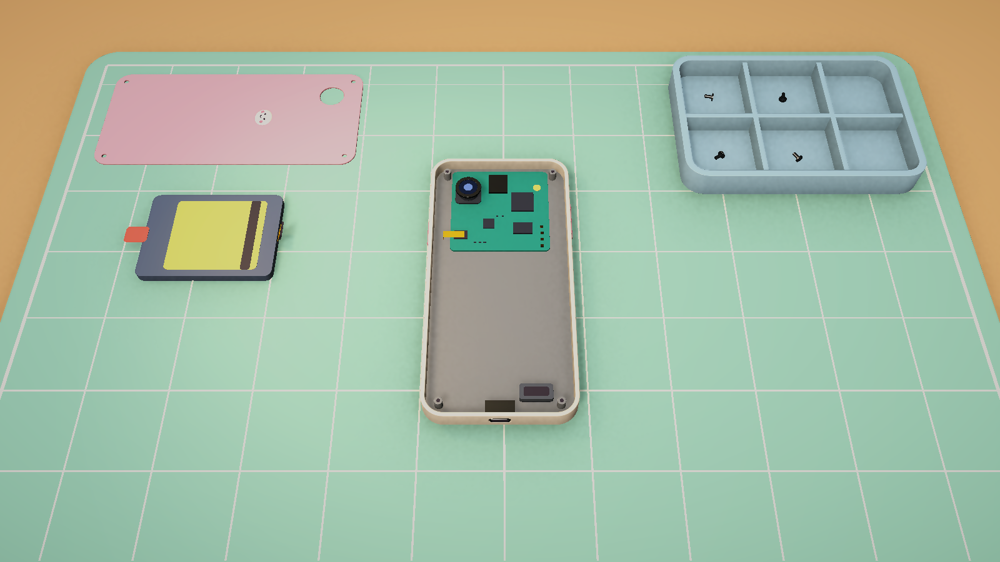
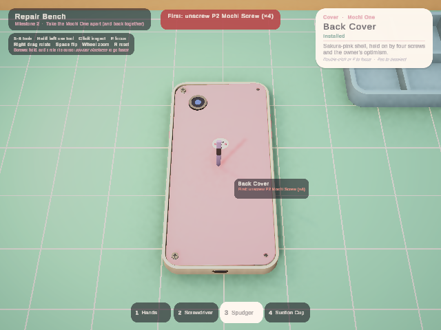
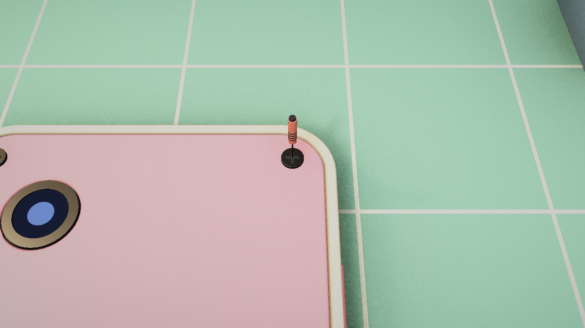
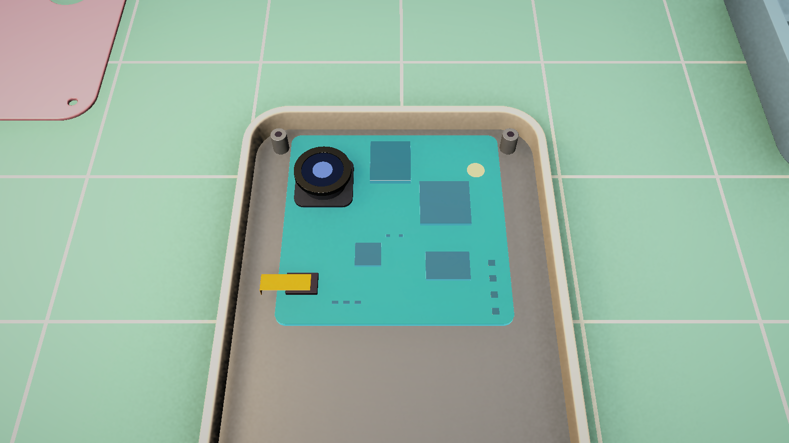
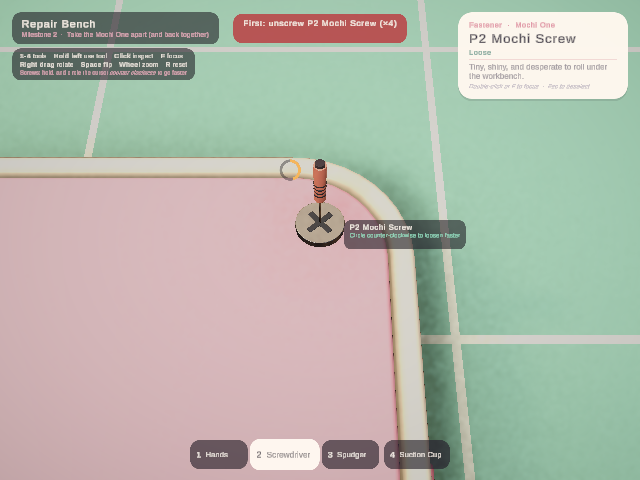

# Milestone 2: Take it apart, put it back

**Objective:** tools, part states and assembly rules, the screwdriver minigame and reassembly, on the Milestone 1 bench.
**Done when:** with the screwdriver you unscrew 4 screws (hold-and-turn minigame), pry the cover, unplug the battery and lift it out, then reverse it. Wrong-order clicks give clear "nope" feedback.
**Status:** implemented and verified headlessly. That exact sequence runs as a PlayMode test through simulated mouse and keyboard (see *Verification* at the end).

---

## 1. Open and play

1. Run **Tools ▸ Phone Repair ▸ Run Setup** once (it was renamed from *Run Milestone 1 Setup*). It adds the tool assets, the repair data and the new HUD, and **regenerates** `Assets/_Project/Scenes/Sandbox/M1_Workbench.unity`.
2. Open that scene and press **Play**.
3. Try the done-when sequence:
   1. **Space** to flip the phone onto its screen.
   2. **2** for the screwdriver. Hold the left button on a screw and circle the cursor counter-clockwise; the screw pops out into the tray. Do all four.
   3. **3** for the spudger. Hold on the cover to pry it off; it lands outside-up on the mat.
   4. With the spudger still in hand, hold on the small yellow battery connector to unplug it.
   5. **1** for your hands. Hold on the battery to lift it out.
   6. Reverse it. With hands: battery on the mat (seat), connector (plug in), cover on the mat (snap on). Then **2** and press a screw in the tray: it flies home and you circle clockwise to tighten it.

Before any of that, try the wrong order on purpose: with the spudger, press on the cover while it is still screwed down.



---

## 2. Controls (new in M2)

| Input | Action |
|---|---|
| **1-4** (also the numpad) | Hands · Screwdriver · Spudger · Suction Cup (or click the tool bar). Keys 5 and 6 are reserved. |
| **Hold left on a part** | use the tool in hand on it: unscrew, pry off, unplug, lift out, or put back. The ring at the cursor shows progress, and letting go early cancels. |
| **Screwdriver: hold + circle** | holding alone turns 0.6 turns/s. Each circle of the cursor around where you pressed adds about 1 turn: **counter-clockwise loosens, clockwise tightens.** A screw keeps its looseness if you let go. |
| **Hold left on a part on the mat / in the tray** | put it back. It flies home; a screw then needs tightening. |
| **Quick click** | inspect or select, as in M1. With a tool that doesn't fit the part, a press only selects it. |

All M1 controls still work. Rotate, flip and reset are locked while an action runs, so the part stays under the tool.

### Feedback

* **Hover:** the tooltip's second line says what a press will do. It is green for "Hold · Pry off", red for the reason it won't work ("First: unscrew P2 Mochi Screw (×4)"), and neutral when the tool is wrong ("Pry off: needs Spudger [3]"). The hover glow follows it: warm for ready, cool grey for neutral, red for blocked.
* **Nope:** pressing in the wrong order wiggles the part, flashes it red, plays a "bonk", and shows the reason in a red toast at the top.
* **Success:** a pop and whoosh as the part flies to the mat or tray, then a thunk when it lands. Ratchet ticks while a screw turns. A green flash with a click when something plugs in or seats, and with its own unplug sound when a connector comes loose.
* **Status:** the info card shows the part's state: *Tight / Loose / In the screw tray*, *Plugged in / Unplugged*, *Installed / On the mat*.



---

## 3. The Mochi One's repair data

Everything below is data. There is no part-specific or phone-specific code.

| Slot | Comes off with | Goes back with | Blocked by (must be off first) | Mounted on (must be in first) |
|---|---|---|---|---|
| `Screw_01..04` | Screwdriver, **Unscrew** (3 turns, minigame) | Screwdriver, **Screw in** | — | BackCover |
| `BackCover` | Spudger, **Pry off** (0.8 s) | Hands, **Snap on** (0.3 s) | the 4 screws | — |
| `BatteryConnector` | Spudger, **Unplug** (0.35 s, flips up on its hinge) | Hands, **Plug in** (0.2 s) | BackCover | Battery, Logicboard |
| `Battery` | Hands, **Lift out** (0.6 s) | Hands, **Seat** (0.3 s) | BackCover, BatteryConnector | — |
| `DisplayConnector` | Spudger, **Unplug** | Hands, **Plug in** | BackCover | Screen, Logicboard |
| `Screen` | Suction Cup, **Lift off** (1.0 s, from the front) | Hands, **Press into place** | DisplayConnector | — |
| `Logicboard` | Hands, **Lift out** (0.6 s) | Hands, **Seat** | BackCover, both connectors, RearCamera | — |
| `ChargingPort`, `RearCamera`, `Speaker` | Hands, **Lift out** (0.5 s) | Hands, **Seat** | BackCover | RearCamera: Logicboard |
| `Frame` | fixed ("holds everything together") | — | — | — |

* **States:** `Secured` → `Loose` → `Removed`. *Loose* means a half-turned screw or an unplugged connector that is still in place. A part *blocks* others until it is fully off: a loose screw still holds the cover, and an unplugged connector no longer holds the battery.
* **Reverse order for free:** "blocked by" decides what can come off, and "mounted on" decides what can go back. A content test checks that every *mounted on* is mirrored by a *blocked by*, which makes the reverse of any valid teardown a valid rebuild.
* **Deliberately allowed:** snapping the cover onto a phone with the battery still on the mat. It's physically possible, and the M3 power-on test is what will complain.
* Connectors are **children of the part they belong to** (battery, screen), so they travel with it when it comes out.

### Adding repair data

* **New part type:** create a `PartDefinition` (*Create ▸ Phone Repair ▸ Part Definition*) and fill the *Repair* block: detach style (*Fixed / Remove / Release In Place*), interaction (*Hold / Screw*), the tool kind for each direction, verbs, times or screw turns, removal direction (part-local), and the hinge axis and angle for connectors.
* **New rule:** edit the slot's *Blocked By* and *Mounted On* lists on the phone's `PhoneModelDefinition`. Slot ids are the model's object names. A typo is reported in the console and by `AssemblyGraphTests.Rules_PointOnlyAtExistingSlots`.
* **New tool:** create a `ToolDefinition` (*Create ▸ Phone Repair ▸ Tool Definition*): kind, model (pivot at the tip, +Y towards the handle) and speed multiplier. Add it to the `ToolBelt`'s list; its position in the list is its hotkey. The M5 upgrade "electric screwdriver" is simply a second Screwdriver-kind tool with a higher speed.

---

## 4. How it works

```
GameInput ─► WorkbenchController ─┬─ press on a part ─► SelectionController.Select
                                  │                    └► RepairInteractor.Begin(part, hit, cursor)
                                  │                         │ Evaluate: direction (off/on), tool kind, rules, room on the mat
                                  │                         ├─ wrong tool  → nothing (it was an inspect click)
                                  │                         ├─ not allowed → RepairFeedback.Refuse (wiggle, red flash, bonk, toast)
                                  │                         └─ allowed     → action runs while the button is held
                                  ├─ held ─► RepairInteractor.Hold(cursor, dt)
                                  │            hold actions: progress over the part's time, the part strains outwards
                                  │            screws: ScrewTurnTracker (hold + circle gesture) → looseness → rise and turn
                                  │            done → PhoneDevice.SetState → PartMover flies it to PartsArea / home
                                  └─ hover ─► RepairInteractor.DescribeHover → HoverHint (text + tone) → tooltip + glow colour
PhoneDevice ─ AssemblyGraph (pure C#: states + blockedBy/mountedOn → RuleCheck with a player-facing reason)
ToolBelt ◄─ 1-4 / tool bar          ToolPresenter: tool model at the cursor, seated in the screw while turning
```

| Script | Job |
|---|---|
| `Devices/AssemblyGraph` | The rules engine, with no Unity objects in it, so it is unit tested. `CanDetach/CanAttach` return `RuleCheck(Allowed, Reason)`. Reasons are grouped: "First: unscrew P2 Mochi Screw (×4), unplug Battery Connector". |
| `Devices/PhoneDevice` | Owns the graph built from the `PhoneModelDefinition`. `SetState` bumps `StateVersion` and raises `PartStateChanged`. `IsFullyAssembled()`. |
| `Devices/PhonePart` | Remembers its installed parent and pose (first call wins, because the prefab is authored assembled). Holds screw looseness and direction, and a busy flag while flying. Reports its status text. |
| `Repair/RepairInteractor` | The verbs: plan, begin, hold, release, finish. It has no input code; the bench controller drives it. |
| `Repair/ScrewTurnTracker` | The screw minigame's input model: hold rate plus signed angle swept around the press point. Pure C# and tested. |
| `Repair/PartsArea` | Landing spots: 3 big, 4 medium and 3 small marked spots on the mat, plus the 6 tray compartments (screws only). It picks the smallest free spot that fits, turned 90° if needed, and lays the part down as the player last saw it. |
| `Repair/PartMover` | Tweens: arcing Bézier flights in the destination's local space (a part flying home lands right even if the phone moved), hinge flips, the nope wiggle, landing squash. |
| `Repair/RepairFeedback` | One place for nope / success: wiggle, highlight flash, sound, toast message. |
| `Repair/ToolBelt`, `ToolDefinition`, `ToolPresenter` | Owned tools and the current one; the 3D tool model at the cursor at a constant screen size. |
| `Audio/SfxPlayer`, `ProceduralSfx` | Eight placeholder sounds synthesised at startup (tick, pop, thunk, click, unplug, nope, whoosh, select). To use recorded clips, drop them into *SfxPlayer ▸ Overrides*. |
| `UI/ToolBarView`, `ToastView`, `ActionProgressView` | Tool bar, top toast, and the progress ring at the cursor. `HoverTooltip` gained a hint line; `SelectionInfoPanel` gained a status line that live-updates. |
| `Interaction/*` | Still game-agnostic. Added `HoverHint` + `InteractionTone`, `Interactable.InfoChanged`, the hover glow coloured by tone, and `InteractionHighlighter.Flash`. |

**Design notes**

* **Rules on the phone's slots, not on part types.** The same P2 screw type can hold different things in different phones.
* **Tool kinds instead of action lists.** A part asks for a kind per direction; any tool of that kind works at its own speed. That covers upgrades without extra code.
* **No minigame base class yet.** The screw gesture is the only minigame. A `RepairMinigame` base will be extracted when the cleaning minigame arrives in M3, from two real cases rather than one guess.
* **The circle is measured around the press point**, not the screw on screen. A screw fetched from the tray may land somewhere off-screen, and the gesture still works.

---

## 5. What changed in the scene (inspector reference)

```
M1_Workbench (regenerated by the setup)
├─ Systems
│  ├─ GameInput · SelectionController · InteractionRaycaster · InteractionHighlighter      (M1)
│  ├─ SfxPlayer          SfxPlayer (master 0.6, 6 voices, Overrides = empty → procedural sounds)
│  ├─ ToolBelt           ToolBelt (Tools = TOOL_Hands, TOOL_Screwdriver, TOOL_Spudger, TOOL_SuctionCup)
│  ├─ PartMover          PartMover
│  ├─ RepairFeedback     RepairFeedback (Sfx, Highlighter, Mover)
│  └─ RepairInteractor   RepairInteractor (Phone, ToolBelt, Mover, PartsArea, Feedback)
├─ Workbench
│  ├─ PhonePivot ─ PHN_MochiOne
│  ├─ PartsArea          PartsArea + Spot_Big_1..3, Spot_Medium_1..4, Spot_Small_1..3 (anchors on the mat)
│  │                     + ENV_Workbench/.../ScrewTray_Slot_0..5 (fasteners only)
│  ├─ ToolPresenter      ToolPresenter (ToolBelt, Repair, Raycaster, Input, Camera)
│  └─ WorkbenchController (+ Repair, ToolBelt)
└─ Canvas
   ├─ Header · ControlsHint (3 lines) · SelectionCard (+ Status line)
   ├─ ToolBar            ToolBarView (clones the inactive ToolButton_Template per tool)
   ├─ Toast              ToastView (Feedback; 2.4 s; red for nope)
   ├─ ActionProgress     ActionProgressView (Track + radial Fill, amber)
   └─ HoverTooltip       HoverTooltip (Label + Hint)
```

Tuning lives on `RepairInteractor`:

| Field | Default | Effect |
|---|---|---|
| Hold Turns Per Second | 0.6 | speed when only holding (3 turns ≈ 5 s) |
| Turns Per Mouse Circle | 1 | extra turns per cursor circle |
| Screw Rise | 1.2 mm | how far a screw backs out before it pops |
| Strain Distance | 1.8 mm | how far a part strains outwards while you hold |
| Hinge Strain | 0.3 | how far a connector lifts while you hold |
| Flight Seconds / Arc | 0.5 s / 5 cm | trips to and from the mat |

Part timings, verbs and tools live on each `PartDefinition`. Tool speed lives on each `ToolDefinition`.

---

## 6. Assets

* **Tools** (`ArtSource/Blender/Scripts/build_tools.py` → `Assets/_Project/Art/Models/Tools/TOOL_*.fbx`): precision screwdriver (coral grip), nylon spudger (lilac), suction cup (sky blue with a ring pull). Each pivot is at the working tip, with +Y running towards the handle. Materials are `M_Tool_*`. Preview: `ArtSource/Blender/Previews/TOOLS_M2.png`.
* **Workbench:** the screw tray now sits on the mat, behind and to the right of the phone. It has six compartments marked by `ScrewTray_Slot_0..5` empties (inner column first).
* **Phone:** `BatteryConnector` and `DisplayConnector` are now children of `Battery` and `Screen`. Their pivots are on the hinge line, flipping 70° about the local X and Z axes.
* **Data:** `Assets/_Project/Data/Tools/TOOL_*.asset`. The Mochi One part assets gained their repair block. Setup fills it in only where it is empty, so later edits stick.
* **UI:** `Assets/_Project/Art/UI/UI_Ring.png` (generated).

---

## 7. Testing

### Automated

* **EditMode** (`PhoneRepair.Tests.EditMode`, 28 tests). New in M2:
  * `AssemblyGraphTests` (10) run on the real Mochi One asset. They check the four screws hold the cover, a half-turned screw still holds it, the battery needs the cover off and the connector unplugged, connectors can't be plugged into a missing battery, screws need the cover, the frame never comes off, mounts are mirrored by blockers, and the reverse of a full teardown rebuilds the phone.
  * `RepairMechanicsTests` (7) cover the screw gesture (hold rate, about 1 turn per circle, the wrong direction doesn't help, the cursor on the centre only counts holding) and parts-area placement (smallest fitting spot, resting on the surface, turned 90° to fit, no room).
  * Content validation: every part has repair data and the tools it asks for exist.
* **PlayMode** (`PhoneRepair.Tests.PlayMode`, 12 tests plus the opt-in HUD capture, all through simulated mouse and keyboard in the real scene):
  * `RepairFlowTests.BatteryOut_AndEverythingBackIn_LeavesThePhoneAsItWas` is the done-when sequence. It checks `IsFullyAssembled()` and that every part is back at its exact original position, rotation and scale.
  * Unscrewing lands the screw in a tray compartment.
  * Prying a screwed-down cover is refused: red hint, "unscrew" toast, and the part is unmoved.
  * The wrong tool only inspects.
  * Every HUD label has a font and produces glyphs.
  * The 7 M1 tests still pass.

Run (Unity closed):

```bash
"C:/Program Files/Unity/Hub/Editor/6000.0.32f1/Editor/Unity.exe" -batchmode -projectPath . -runTests -testPlatform EditMode -assemblyNames PhoneRepair.Tests.EditMode -testResults Logs/editmode.xml
```

```bash
"C:/Program Files/Unity/Hub/Editor/6000.0.32f1/Editor/Unity.exe" -batchmode -projectPath . -runTests -testPlatform PlayMode -assemblyNames PhoneRepair.Tests.PlayMode -testResults Logs/playmode.xml
```

Screenshots:

* **Scene shots** (no Play mode): *Tools ▸ Phone Repair ▸ Capture Workbench Screenshots*. This includes the M2 close-up, the opened phone, and the selected logic board.
* **HUD shots** (Play mode, opt-in test):

```bash
"C:/Program Files/Unity/Hub/Editor/6000.0.32f1/Editor/Unity.exe" -batchmode -projectPath . -runTests -testPlatform PlayMode -assemblyNames PhoneRepair.Tests.PlayMode -testFilter CaptureRepairUi -captureOut Screenshots
```

### Manual checklist (5 minutes, with a real mouse and sound on)

- [ ] Keys 1-4 and clicking the tool bar switch tools; the tool model follows the cursor and tilts towards you.
- [ ] Hover a screw with hands: neutral "Unscrew: needs Screwdriver [2]". With the screwdriver: green "Hold · Unscrew".
- [ ] Holding on a screw turns it slowly. Circling counter-clockwise is clearly faster; clockwise does nothing. Ticks are audible.
- [ ] The screw rises, pops, spins into a tray compartment and thunks.
- [ ] Pressing the cover with the spudger while any screw is in: wiggle, red flash, bonk, red toast.
- [ ] The cover lifts off with a little strain and lands outside-up on the mat. The battery lands label-up.
- [ ] The connector flips up when unplugged; the battery refuses to come out until it does.
- [ ] Reassembly in reverse works. Screws fly home from the tray and tighten clockwise. The card shows *Tight* at the end.
- [ ] You can't rotate the phone while holding an action; letting go early snaps a hold back, but a screw keeps its looseness.
- [ ] The HUD reads well at your resolution (the automated shots were 640×480).

---

## 8. Likely problems

| Symptom | Cause / fix |
|---|---|
| Tool bar empty / keys 1-4 do nothing | `ToolBelt ▸ Tools` has empty entries. Re-run the setup; it now refuses to build the scene with a missing tool. |
| "No room left on the mat" | Every spot that fits is taken. Add spots to `PartsArea` (an anchor plus a size) or put parts back. |
| A screw won't come out when circling | Circle around the point where you pressed, not around the screw on screen. Very small circles (under 10 px) only count as holding. |
| Parts fly to odd places | `PartsArea` anchors moved, or a slot's *Fasteners Only* flag is wrong. Anchors must have +Y up. |
| New part can't be removed | Missing repair data: its verb is empty, or the tool kind isn't on the belt. The content tests name the slot. |
| No sound | `SfxPlayer` is missing, or the game view is muted. The clips are generated at runtime; nothing needs importing. |
| Editor capture: parts stay in the phone | Only in edit mode (prefab instances can't be restructured). The capture tool unpacks its in-memory copy; Play mode is unaffected. |

---

## 9. Completion criteria

- [x] Tools: hands, screwdriver, spudger, suction cup; hotkeys and tool bar; 3D tool model at the cursor
- [x] Part states (secured / loose / removed) and data-driven assembly rules with player-facing reasons
- [x] Screw minigame: hold to turn; circle counter-clockwise to loosen faster and clockwise to tighten
- [x] Pry the cover, unplug connectors, lift parts out; parts fly to mat spots and the screw tray
- [x] Reassembly by reversing; screws come back from the tray and tighten
- [x] Wrong order: hover warning plus nope (wiggle, red flash, sound, toast); wrong tool: hint only
- [x] No phone- or part-specific code: everything comes from `PartDefinition`, `PhoneModelDefinition` and `ToolDefinition` data
- [x] Automated EditMode and PlayMode tests pass headlessly, including the full done-when sequence

---

## Verification log

Verified 2026-10-21, headless, with Unity 6000.0.32f1 and Blender 5.2.2.

| Step | Result |
|---|---|
| Blender: `build_phone_mochi_one.py`, `build_env_workbench.py`, `build_tools.py` | ✅ FBX exported, previews checked |
| Compile (runtime, editor, both test assemblies) | ✅ no errors or warnings from project code |
| `ProjectSetup.RunBatch` (9 steps: tools, repair data, rules, prefabs, scene, HUD) | ✅ 17 s, no warnings |
| EditMode tests | ✅ 28 / 28 |
| PlayMode tests (simulated mouse and keyboard, real scene) | ✅ 12 / 12. The opt-in HUD capture is skipped unless `-captureOut` is given. |
| Review shots: scene (`SceneCapture`) and HUD (`CaptureRepairUi`) | ✅ below |

Bugs the verification caught, all fixed before hand-off:

1. **Tool keys did nothing.** The scene's `ToolBelt` held four empty references. The setup opens a fresh scene, which makes Unity unload assets that only C# variables point at, and the tool assets had just been created. The builder now re-fetches them after opening the scene and refuses to build if one is missing; the PlayMode tests also check the belt first. *(PlayMode tests)*
2. **A screw fetched from the tray could land off-screen while the gesture was measured around it.** Circles are now measured around the point where the button went down. *(review while writing the reassembly test)*
3. **The landing squash reset parts to scale 1.** It now keeps each part's own scale. The full-flow test checks scale too.
4. **Parts landed as if taken from a face-up phone.** The cover showed its inside and the battery its back, although both came off the back. They now land the way the player saw them. *(review screenshots)*
5. **The progress ring was mint on the mint mat.** It is now amber on a darker track, and larger. *(HUD screenshots)*
6. **Tooling:** in edit mode, the capture tool could not move parts out of the prefab instance, so it now unpacks its in-memory copy. Batch mode has no game view and drops TextMeshPro text in near-plane camera canvases, so the HUD capture renders the HUD separately and composites it. A PlayMode test guards that every label produces glyphs.

| Screwdriver seated (scene) | Opened, parts on the mat (scene) | Logic board selected (scene) |
|---|---|---|
|  |  |  |

| Wrong order: red hint, toast, nope (HUD, 640×480) | Unscrewing: gesture hint, progress ring (HUD, 640×480) |
|---|---|
|  |  |

**Not verified by automation:**

* Feel with a real mouse: circle speed, hold times, how the strain and flights read.
* The sounds: they are generated procedurally and have never been heard, because every run was headless.
* The HUD at full HD: the automated HUD shots are 640×480.

The manual checklist in section 7 covers these.
