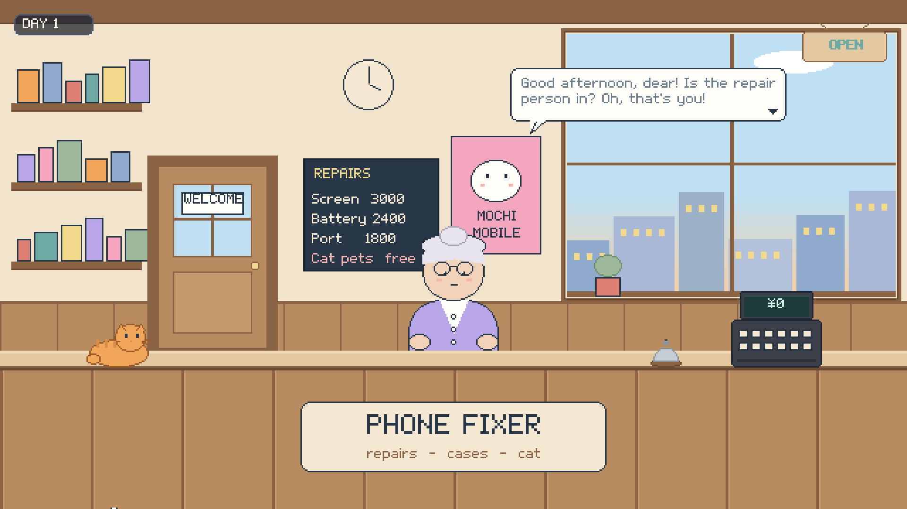
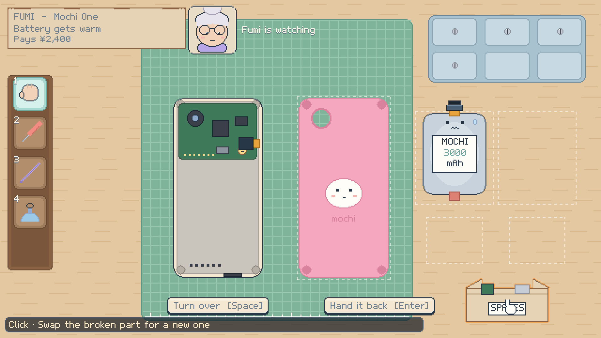
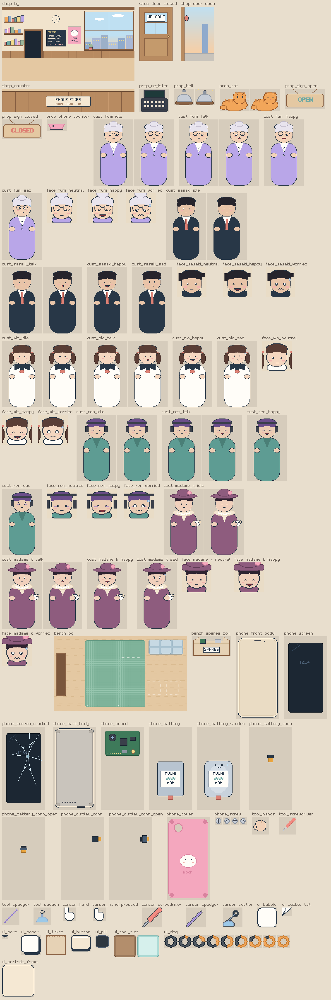

# S1: Shop and bench (the 2D restructure)

**Objective:** turn the game into a 2D, pixel-art, behind-the-counter game. People come in, you fix their phones with little motion and lots of goofiness. Ship it as a playable loop with placeholder art and an art contract, ready for the redesign in the art artifact.
**Status:** implemented and verified headlessly. See *Verification* at the end.

---

## 1. Play it

1. Open the project in Unity 6000.0.32f1 and switch to the `2d-restructure` branch if needed. The setup has already been run; after pulling art or changing data, run **Tools > Phone Repair > Run Setup**.
2. Open `Assets/_Project/Scenes/Shop.unity` (the only scene in Build Settings) and press **Play**.
3. **Open the shop** (Enter). Fumi hops in. Listen, take the job with **1**, and fix her swollen battery on the bench.
4. For the best look, set the Game view to 1920×1080 or another 16:9 multiple of 640×360.



## 2. Controls

| Where | Input | What |
|---|---|---|
| Shop | **Click**, **Enter** or **Space** | finish the line, then continue |
| | **1** / **2** or click | "Leave it with me!" / "Sorry, can't" |
| | click the **cat** or the **bell** | meow / ding (they hop) |
| Bench | **1-4** or click the rack | Hands, Screwdriver, Spudger, Suction Cup |
| | **hold left** on a part | do what the status line says: unscrew, pry off, unplug, lift out, put back |
| | **screws:** hold + **circle** the mouse | anticlockwise loosens faster, clockwise tightens; it counts circles around where you pressed |
| | **Space** or "Turn over" | flip the phone (front: screen; back: cover and insides) |
| | click the **parts box** | swaps a broken part lying on the mat for a new one |
| | **Enter** or "Hand it back" | ring the bell and give the phone back (only when it's back together) |

The status line at the bottom of the bench always says what pressing would do:
- **orange:** it works;
- **cream:** wrong tool, and it names the right one;
- **coral:** not yet ("First: unscrew P2 Mochi Screw (×4)").

## 3. One repair, step by step (Fumi's swollen battery)

1. **Space:** turn the phone over to its back.
2. **2**, then unscrew all four screws. They pop into the tray.
3. **3**, then pry off the cover. It lands on the mat.
4. With the spudger still in hand, unplug the battery connector.
5. **1**, then lift out the battery. It's swollen, and it has a worried face.
6. Click the **parts box**. The swollen battery dives in and a fresh one pops out.
7. Reverse it: seat the battery, plug the connector, snap the cover on, then **2** and screw all four in clockwise.
8. **Enter:** she switches it on. "Cool as a cucumber!" ¥2,400 and a mikan.

**Screen jobs** (Mr. Sasaki, Ren, Madame K.) start the same way:
1. Open the back: screws, then the cover.
2. With the spudger, unplug the **display connector**. The screen won't lift while its cable is in, and the status line says so.
3. **Space**, **4**, then lift the screen off the front with the suction cup.
4. Swap it at the parts box.
5. **1**, then press the new screen into place.
6. Turn the phone over, plug the cable back in, snap the cover on and screw it shut.



## 4. How it fits together

```
GameInput ─► PointerRouter ─┬─ hover: PointerPicker2D (front-most sprite) → SpriteHighlighter outline + StatusLine prompt
                            ├─ click: IClickable (PixelButton, ToolSlot, SparesBox, Pettable)
                            └─ hold on a part: BenchRepair (Evaluate → Begin → Hold → Release)
                                                 ├─ rules: PhoneDevice → AssemblyGraph (M2, unchanged)
                                                 ├─ screws: ScrewTurnTracker (M2, unchanged)
                                                 └─ PartFlights2D → PartsTray2D (mat spots, screw tray)
ShopDirector (one coroutine, top to bottom) ─► CustomerActor, SpeechBubble, ChoicePrompt, Wallet, PanelView
                                            └► BenchController (puts the phone on the mat, keys, hand back) + CameraRig2D slide
```

- **One scene, two views.** The shop view is world y 0..360 and the bench view is y -360..0. The camera slides between them once per job.
- **World space everywhere.** UI included: speech bubbles, buttons, the ticket and the status line are sprites and bitmap text in the world. They are pixel-perfect and pick-able like everything else.
- **The phone is layers.** `PHN_MochiOne_2D` has a *Front* (body, screen) and a *Back* (insides, board, battery with its connector, display connector, cover, 4 screws). Every part is a `PhonePart` with the same slot id as the Milestone 2 data, so the rules carried over untouched. Removed parts leave both sides and rest on the mat.
- **Faults** are `PhonePart.Condition` (Good/Broken). A broken part shows its broken sprite. The power test (`JobTicket.PowerTest`) needs every part fastened and nothing broken inside.

## 5. Data

| Customer | Fault | Pays | Tip | Voice |
|---|---|---|---|---|
| Fumi | swollen battery ("gets warm") | ¥2,400 | a mikan | high, cheerful |
| Mr. Sasaki | cracked screen | ¥3,000 | a business card | low, in a hurry |
| Mio | puffy battery (dropped in ramen) | ¥2,400 | a cat sticker | high |
| Ren | cracked screen | ¥3,000 | an energy drink | flat |
| Madame K. | cracked screen (Bijou the dog) | ¥4,500 | a pearl | grand |

- **Calendar** (`Data/Shop/CAL_Default`):
  - Day 1: Fumi, Sasaki, Mio.
  - Day 2: Ren, Madame K., Fumi.
  - Day 3: Sasaki, Mio, Madame K.
  - Then it repeats.
- **Assets:** customers are `Data/Customers/CUS_*`. The setup creates them once; your edits to lines, prices or faults are kept, and only sprite links are refreshed.

## 6. Art pipeline (for the art artifact)

- **The contract.** `Assets/_Project/Art/Pixel/art_contract.json` lists all 103 files: size, pivot, frames, 9-slice border and placement for each, plus the named layout anchors. It is readable as **`Docs/Art_Contract.md`**, with a contact sheet of every sprite. That doc is the brief for the redesign.
  - Shop: 13 files.
  - Customers: 45 files (5 characters × 9).
  - Bench: 2 files.
  - Phone: 15 files.
  - Tools and cursors: 9 files.
  - UI: 19 files.
- **Delivering art.** Save a PNG over the placeholder with the same name, then run setup. The importer applies the pixel-art settings (point filter, no compression, 1 pixel per unit, Full Rect, physics shape) and the contract's pivot and border.
- **Placeholders never overwrite your art.** `ArtSource/Pixel/placeholders.json` records the hash of each generated placeholder. A file whose hash differs counts as yours and is left alone.
- **Status.** *Tools > Phone Repair > Art Contract Status* lists what is still placeholder.
- **Not in the contract yet:** the font. A hand-made 5×7 placeholder font is generated by code. A designed pixel font needs your OK to download, or can be drawn as an atlas.



## 7. Testing

**EditMode** (29 tests):
- the M2 assembly rules on the real Mochi One data (10);
- the screw gesture (4) and the 2D parts tray (3);
- pixel text and the font (4);
- the art contract on disk: every file exists at the agreed size, pivot and border, imported as crisp pixel art (4);
- content: customers complete, calendar, phone prefab, tools (4).

**PlayMode** (8 tests plus an opt-in capture), all through a simulated mouse and keyboard in the real scene:
- title, then the first customer walks in and talks;
- saying no sends them away and the next one comes in;
- **the full battery job**: back off, 4 screws by the circle gesture, cover, connector, battery out, swap at the box, everything back, hand back, paid ¥2,400;
- **the full screen job** (Mr. Sasaki): the screen refuses to lift while its cable is plugged in; then back open, cable unplugged, flip, suction cup, swap, press on, flip, cable, cover, screws, paid ¥3,000;
- prying a screwed-down cover says nope;
- handing back a phone in pieces is refused;
- handing back without fixing earns nothing;
- the day ends after the last customer with a summary (still day 1: mashing Enter can't skip it), then day 2 starts.

Run (Unity closed):

```bash
"C:/Program Files/Unity/Hub/Editor/6000.0.32f1/Editor/Unity.exe" -batchmode -projectPath . -runTests -testPlatform EditMode -assemblyNames PhoneRepair.Tests.EditMode -testResults Logs/editmode.xml
```

```bash
"C:/Program Files/Unity/Hub/Editor/6000.0.32f1/Editor/Unity.exe" -batchmode -projectPath . -runTests -testPlatform PlayMode -assemblyNames PhoneRepair.Tests.PlayMode -testResults Logs/playmode.xml
```

Screenshots of the running game (3× pixels, 1920×1080):

```bash
"C:/Program Files/Unity/Hub/Editor/6000.0.32f1/Editor/Unity.exe" -batchmode -projectPath . -runTests -testPlatform PlayMode -assemblyNames PhoneRepair.Tests.PlayMode -testFilter CaptureShopScreenshots -captureOut Screenshots
```

### Manual checklist (5 minutes, sound on)

- [ ] The door chimes, the customer appears small in the doorway and hops up to the counter.
- [ ] Talk blips match each customer's voice; a click finishes the line, another continues.
- [ ] The bench slide feels quick, and the customer's face peeks in at the top and winces at a "nope".
- [ ] The screwdriver circle feels good; the screw slot visibly turns and the screw backs out a pixel or two.
- [ ] The cursor turns into the tool in hand on the bench, and back into a hand in the shop.
- [ ] Pixels stay crisp at your window size (16:9 is best).

## 8. Likely problems

| Symptom | Cause / fix |
|---|---|
| Blurry or uneven pixels | The window isn't 16:9 or isn't a whole multiple of 640×360. Stretch-fill keeps it full screen but uneven; use 1920×1080 or 2560×1440. |
| Everything pink | The URP 2D asset isn't assigned. Run setup (it assigns `PRS_URP_2D`). |
| Text missing | The font asset or material is missing. Run setup (it rebuilds `FNT_Pixel`). |
| New art looks offset | Its size differs from the contract, or it is missing the transparent padding. Check `Docs/Art_Contract.md`. |
| A part can't be clicked | Colliders come from the sprite's physics shape at runtime, and fully transparent art has none. Check the part's PNG. |
| Enter does nothing for a moment when the title or the summary appears | On purpose: panels ignore input for 0.35 s after opening, so a key mashed through the last line can't skip them (`PanelView` › Input Delay). |
| The scene lost your hand edits | The setup regenerates `Shop.unity`. Put tweaks in the builder or the art contract, or copy the scene. |
| Batch runs fail with "project already open" | Close the editor first. |

## 9. Completion criteria

- [x] 2D, behind-the-counter shop view with customers walking in (door → counter, 2.5D by scale)
- [x] Goofy customers: faces, poses, talk blips, five characters with their own stories and tips
- [x] Take or refuse a job; the phone goes to the bench; hand it back; power test; pay or grumble; customer leaves
- [x] The 2D repair bench uses the Milestone 2 rules: tools, screws with the circle gesture, pry, unplug, lift, flip, reassembly, nope feedback
- [x] Faults: a broken part (swollen battery, cracked screen) swapped at the parts box
- [x] Day loop with summary; money on the register
- [x] Pixel-perfect rendering at 640×360 (URP 2D, Pixel Perfect Camera, bitmap font)
- [x] Art contract plus placeholders plus drop-in pipeline for the redesign
- [x] 3D work snapshotted in git and archived; reusable systems carried over
- [x] Automated EditMode and PlayMode tests pass headlessly

---

## Verification

Run on 2026-10-22, headless (Unity 6000.0.32f1 batch mode, Windows 10), on the final code:

| Step | Result |
|---|---|
| Run Setup | OK in 14 s. No compiler errors or warnings. 103 contract files, all placeholders (no real art yet). |
| EditMode | **29 / 29** passed |
| PlayMode | **8 / 8** passed in 48 s, including both full repairs by simulated input (battery 12 s, screen 15 s). The opt-in capture is skipped in a normal run. |
| Capture | passed: the 9 screenshots in `Docs/Images/S1/` |

**Bugs found while building and verifying S1 (all fixed):**

*Build and tooling*
1. URP 17 keeps its 2D types (`PixelPerfectCamera`, `Renderer2DData`) in their own assembly, so the editor assembly didn't compile. It now references `Unity.RenderPipelines.Universal.2D.Runtime`.
2. `Renderer2DData.postProcessData` is internal in URP 17. The setup no longer touches it.
3. The sprite shader named a variable `step`, which shadowed the HLSL intrinsic. Renamed.
4. `WalletLabel` sat inside `Wallet.cs`. It now has its own file; Unity drops MonoBehaviours whose file name doesn't match.
5. The first capture after a scene load drew every sprite with the bench background texture: a stale binding on the first manual render request. The capture now renders twice; the later shots were fine either way.

*Visual*
6. The placeholder painter inverted the phone collider's V-neck, and the shop window's houses overflowed its frame. Both fixed.
7. Flipping the phone scaled it to zero width for a frame, which collapsed its colliders. The flip now stops at 5 %.
8. "Hand it back" was drawn as a 40×10 pill: the button sized itself before its label had built its text. It now builds the label first.
9. The choice buttons covered the counter sign. They moved under the speech bubble.
10. The job ticket overlapped the portrait, and its text was low-contrast. It is narrower now, with dark ink text.
11. The swollen battery's worried face overlapped its label. It moved above it.

*Gameplay*
12. **A mashed Enter could skip the day summary.** The day-end test failed once: an Enter landing a few frames after the summary opened dismissed it, so day 1's summary flashed by and the test reached day 3. Panels now ignore input for 0.35 s after opening, and the test asserts it is still day 1 at the summary.

**Not covered by automation:**
- How it feels with a real mouse: the circle gesture, hover, the cursor.
- Sound: the procedural SFX are generated but nobody has listened to them.
- Pixel crispness through the Pixel Perfect Camera at real window sizes. Captures render at 640×360 with that camera off and are scaled 3× by the test.
- Days 2-3 past the start of day 2.
- Mio's job, which is the same as Fumi's, and Ren's and Madame K.'s, which are the same as Mr. Sasaki's.

Please run the manual checklist in section 7.
