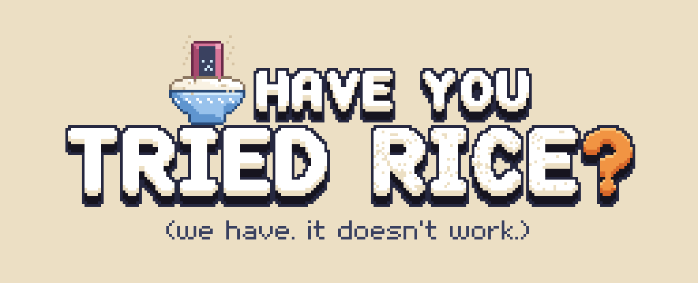
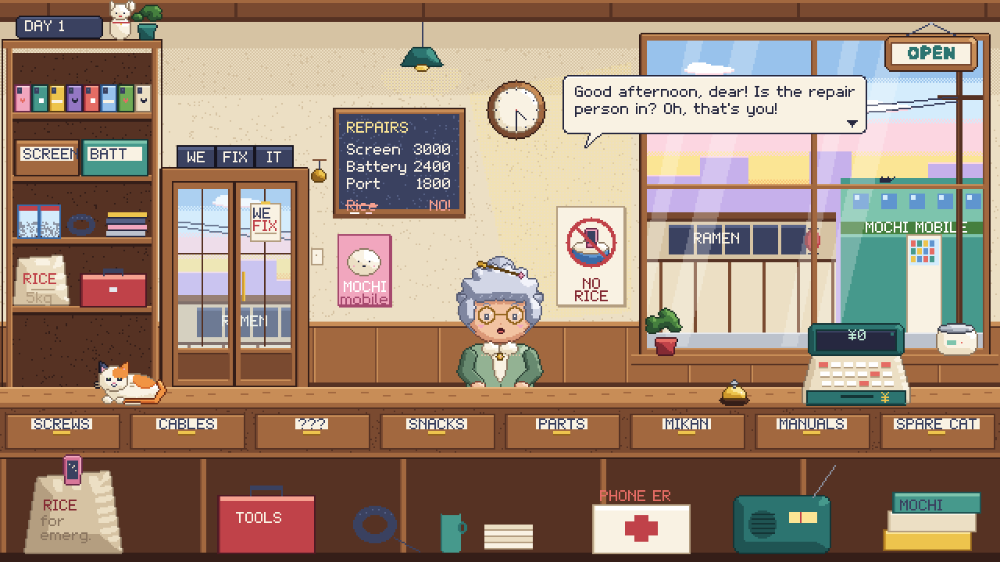
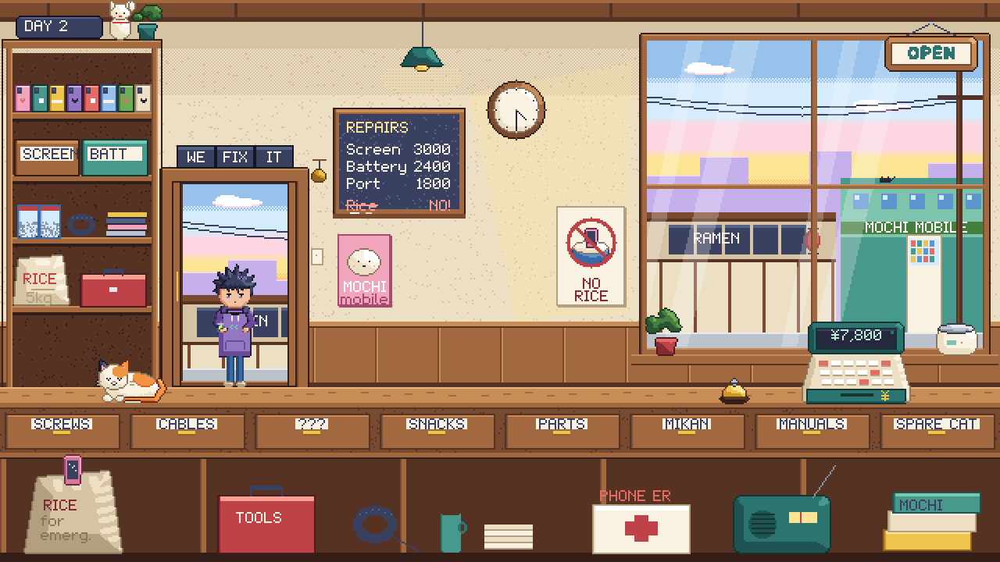
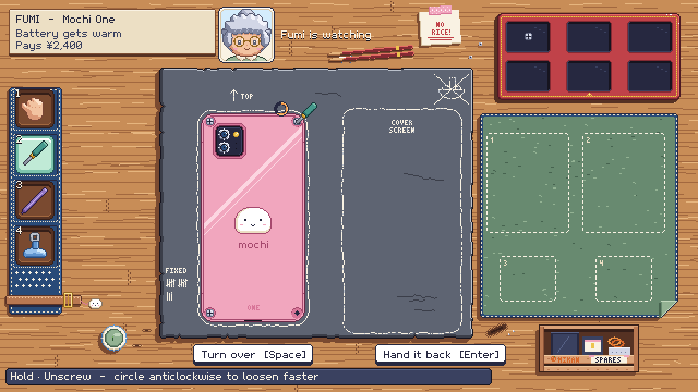
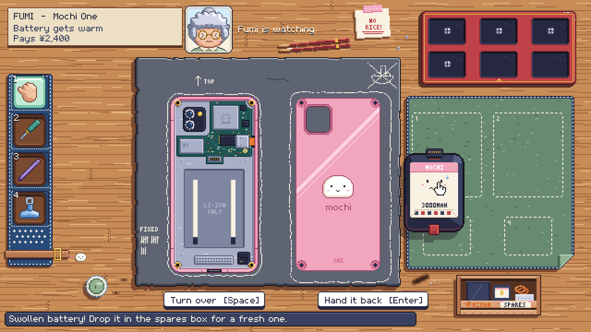

# Have You Tried Rice?

**A goofy phone repair game in pixel art, made in Unity 6, in early production.** You run a tiny phone repair shop and work behind the counter:
- the door chimes, and someone hops up with a broken phone and a ridiculous story ("I dropped it in ramen. Tonkotsu.");
- take the job, and the phone goes down to your bench;
- open it with the right tools in the right order, swap the broken part and put it back together;
- hand it back. If it powers on, they pay, plus a goofy tip.

Everyone's first fix for a wet phone is a bag of rice. This shop has heard it a thousand times.

| | |
|---|---|
|  |  |
|  |  |

*Mockups composed from the finished sprites by the art scripts, shown at 2×. The art isn't installed in the game yet (see [Status](#status)).*

---

## Gameplay

- **Customers hop in.** Five goofy regulars, each with a face, a voice (talk blips at their own pitch), a dumb story, a reaction to how you treat their phone, and a tip:
  - Fumi's Mochi One gets warm, "like a little hand warmer";
  - Mio dropped hers in ramen;
  - Mr. Sasaki has a meeting in twenty minutes;
  - Ren's fell off the bed mid-raid;
  - Madame K.'s very large dog, Bijou, sat on hers.
- **Take the job or turn it down.** Turned away, they leave sad. Take it, and the phone goes on the counter while the camera slides down to the bench.
- **Repair it by hand.**
  - Pick a tool from the rack (hands, screwdriver, spudger, suction cup), then hold on a part to unscrew, pry off, unplug, lift out or put back.
  - Screws are a little minigame: hold and circle the mouse, anticlockwise to loosen faster.
  - Flip the phone to work on its front or its back.
  - The status line always says what pressing would do. A wrong move gets a "nope" with the reason ("First: unscrew P2 Mochi Screw (×4)").
- **Swap the broken part** (a swollen battery or a cracked screen) at the spares box, put everything back, and ring the bell.
- **The power test decides it.** Fixed: a happy line, the payment and a tip. Still broken: they grumble and leave without paying.
- **Days:** a calendar of customers, then the CLOSED sign and a summary of the day's repairs, money and tips. The cat can be petted.

## Status

The project started in October 2026 as a 3D repair sim and was **restructured into this 2D game on 2026-10-22**. The repair rules, the phone data and the tools carried over. The 3D version is preserved in git history.

- **S1, the playable loop, is done:** customers, the counter, the bench, battery and screen repairs start to finish, payment and the day summary, all on placeholder art. It was verified headlessly on 2026-10-22: 29 of 29 EditMode and 8 of 8 PlayMode tests passed, including both full repairs played by simulated input.
- **S2, the art pass, is under way.**
  - All 103 sprites in the art contract are drawn, along with the logo and three pixel fonts. The bench art was reworked on 2026-10-25.
  - The art isn't installed in the game yet, so the in-game title card still reads "PHONE FIXER".
- **Planned:**
  - S3: hidden faults that need a tool to find, a cleaning minigame and a second phone;
  - S4: spare parts that cost money, haggling, upgrades and saving;
  - S5: more customers and days, music, settings and a Steam demo.

## Tech stack

| Area | What it uses |
|---|---|
| Engine | **Unity 6** (6000.0.32f1), **URP 17** with the 2D Renderer and the Pixel Perfect Camera, Input System |
| Look | Pixel art at **640×360**, shown at 3× on 1080p (4× on 1440p, 6× on 4K). One world unit is one pixel. |
| Rendering | Everything, the UI included, is sprites and bitmap text in the world, so the UI is pixelated exactly like the art. One unlit sprite shader draws the hover outline and the flash. There's no Animator: just flipbooks and small hops in code. |
| Data | Customers, the phone and its parts, the repair rules, the tools and the day calendar are assets. A new phone needs its art layers plus data; a new customer needs a sprite set plus one asset. |
| Art pipeline | An **art contract** (`art_contract.json`) lists all 103 sprites with their size, pivot, frames and 9-slice. The editor paints a placeholder for each, and real art replaces them file by file: the importer applies the settings and the scene picks the art up. |
| Pixel art | **Drawn in code** by 12 Python scripts (Pillow, NumPy, SciPy): the sprites, the logo and three pixel fonts, from a palette of 17 colour ramps. `export.py` checks every file against the contract (size, frames, and a clear border for the hover outline). |
| Scene setup | One editor command, **Run Setup**, builds the scene, prefabs, materials, the font atlas and the art contract report. It runs headlessly and is safe to run again. |
| Audio | Sound effects synthesized in code |
| Testing | Unity Test Framework: 29 EditMode and 8 PlayMode tests, run headlessly, plus an opt-in test that captures the review screenshots |

## What I built

All of it: 77 C# scripts (about 11k lines) and 2 shaders, plus the 12 Python scripts that draw the art (about 4.9k lines).

| Area | Where |
|---|---|
| The shop: the day loop (`ShopDirector`), customers, speech bubbles, choices, the camera slide, the wallet, panels, the cat | `Assets/_Project/Scripts/Runtime/Shop/` (18 scripts) |
| The bench: the repair verbs (`BenchRepair`), the phone's front and back, the parts tray, the spares box, the tool rack, the status line | `Runtime/Repair/` (13 scripts) |
| The repair rules, kept from the 3D version: `AssemblyGraph`, the phone and part definitions, `ScrewTurnTracker`, `ToolBelt` | `Runtime/Devices/` (8 scripts), `Runtime/Repair/` |
| The pixel layer: bitmap text, flipbooks, pixel snapping and sort order; 2D picking and the hover outline | `Runtime/Pixel/`, `Runtime/Interaction/` (7 scripts each) |
| Editor: Run Setup, the art contract and importer, the placeholder painter, the font builder, the scene and prefab builders | `Assets/_Project/Scripts/Editor/` (15 scripts) |
| Shaders: the sprite outline and flash, the pixel text | `Assets/_Project/Art/Shaders/` |
| Tests | `Assets/_Project/Scripts/Tests/` (EditMode and PlayMode) |
| The art scripts | `ArtSource/Pixel/Scripts/`: `px.py` (canvas, cel shading, outlines, dithering, palette), `figure.py` and `cast.py` (the five customers), `shop.py`, `bench.py`, `phone.py` (the 12 Mochi One layers), `ui.py`, `pxfont.py`, `export.py` |

### Code highlights

- **The rules outlived the 3D version.** The assembly rules, screw tracking and tool checks moved to 2D unchanged, with their tests; only the presentation was rebuilt.
- **One art contract drives the whole pipeline:** the placeholder painter, the importer (pivots, 9-slice, pixel settings), the prefabs and the scene, the report in `Docs/Art_Contract.md`, and the Python exporter's checks. Installing the real art is just saving PNGs over the placeholders.
- **`ScrewTurnTracker`:** the circle gesture counts turns around the point where you pressed. Anticlockwise loosens faster, and clockwise tightens.
- **`PointerPicker2D`:** the front-most sprite under the cursor wins, and colliders come from each sprite's own shape.
- **The PlayMode tests play the game:** both full repairs run on simulated input (the battery in 12 s, the screen in 15 s). An opt-in test captures the screenshots in `Docs/Images/S1`.

## Scenes

| Scene | Purpose |
|---|---|
| `Assets/_Project/Scenes/Shop.unity` | The game, and the only scene in Build Settings. **Run Setup** regenerates it. |

## Integrated third-party assets

No Asset Store content. The game's text uses its own bitmap font; TextMesh Pro's essential resources from Unity are still in `Assets/TextMesh Pro`, left over from the 3D version.

## Docs

- [`Docs/00_Game_Plan.md`](Docs/00_Game_Plan.md): the game in one breath, the pillars, the core loop, how it is built, the milestones and the open decisions
- [`Docs/S1_Shop2D.md`](Docs/S1_Shop2D.md): S1, the 2D restructure: how to play, the controls, a repair step by step, the art pipeline, verification and the bugs found on the way, with [in-game screenshots](Docs/Images/S1)
- [`Docs/Art_Contract.md`](Docs/Art_Contract.md): every sprite with its size, pivot and frames, generated by Run Setup
- [`Docs/Pixel_Art_Direction.md`](Docs/Pixel_Art_Direction.md): the name, the pixel art rules, the palette, the type and the art scripts

## About this repository

This public repository is a **showcase**. It contains the documentation and the **96 source files I wrote** for this project. The complete Unity project, with the sprites, the earlier 3D version and its Unity Cloud link, is kept in a private repository.

Copyright © Omer Avcioglu (McHunter Studio). **All rights reserved.** Viewing only; see [LICENSE](LICENSE).
